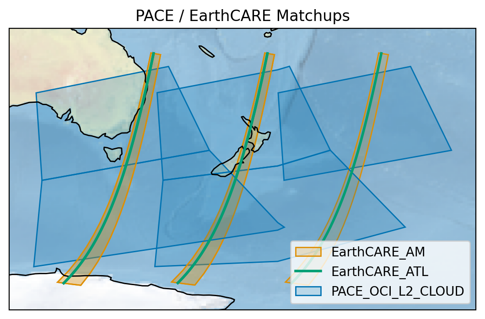

# Summary

Intercomparison of data from different Earth-observing platforms (satellites) can yield scientific insights beyond what can be achieved with one platform alone. Such is the case for NASA's Plankton, Aerosol, Cloud, ocean Ecosystem (PACE) [@Werdell2019PACE; @Werdell2024PACE; @Werdell2026PACE] and the ESA / JAXA Earth Cloud Aerosol and Radiation Explorer (EarthCARE) missions [@amt-16-3581-2023]. PACE and EarthCARE have complementary orbits for which simultaneous observations occur frequently in some parts of the world. Combined observations can provide a more complete understanding, additionally, comparisons of similar observations can be used to assess their quality. For example, vertical profiles of cloud top height from EarthCARE's Atmospheric Lidar (ATLID) [@amt-16-4031-2023] are used to validate the wide spatial swath observations of the same by PACE's Ocean Color Instrument (OCI) Cloud Height Retrieval from O2 Molecular Absorption (CHROMA) algorithm [@amt-16-969-2023]. However, there are logistical hurdles to this type of synergistic science, due to differences between file formats, geospatial grids, and data dissemination systems. PACE-EarthCARE Matchups (PEM) is an open-source Python library which allows researchers to easily search and download spatiotemporally overlapping granules, plot matchups, and interpolate data to a shared grid.

# Statement of need

PEM's target audience is all researchers seeking to use co-located PACE and EarthCARE observations in their work. While there are numerous potential applications of PACE and EarthCARE intercomparisons, efficiently searching and co-locating these data products requires substantial coding effort. By simplifying data search and intercomparison to a few lines of Python, PEM widens the field of researchers who use PACE and EarthCARE in their work. Furthermore, by providing configurable and canonical co-location approaches, PEM improves the reproducibility of its users' research.

# State of the field

NASA, ESA, and JAXA have made significant strides towards enabling multi-mission science. NASA and ESA have a collaborative effort, the Multi-Mission Algorithm and Analysis Platform (MAAP) which centralizes data access and algorithm development into a single cloud platform [@bugbee2020advancing]. However, the NASA MAAP and ESA MAAP are distinct efforts.  While authentication for both agencies can be done with either a NASA EarthData or ESA account, there are different APIs for downloading NASA and ESA data.  While both NASA and ESA data search services allow the specification of bounding geospatial polygons, they utilize different specifications, preventing users from simply passing geospatial metadata from one API to the other. Furthermore, these APIs are meant to help users find and download data; the interpolation and co-location of specific products exceeds their scope, but is a complex pre-requisite for multi-mission science. PEM builds on top of these tools.

Libraries like `xarray` [@Hoyer_xarray_N-D_labeled_2017], `scipy` [@virtanen2020scipy],  and `numpy` [@harris2020array] contain tools that simplify interpolation and re-gridding of geospatial data. While these tools are useful, leveraging them for multi-instrument comparisons requires expertise and nontrivial coding effort.

User interactions with PEM include search, download, plotting, and intercomparison. PEM does not fit neatly into the scope or user model of any existing library. The agency-spanning scope of PEM also necessitates its status as a standalone library that builds upon the existing NASA and ESA MAAP tools.

# Software design

In PEM, a matchup consists of one PACE granule and one or more EarthCARE granules, each of which receives a dense overlap mask (granules are a portion of observations made by an instrument associated with a defined fraction of an orbit time). PACE granules are used as the outer hierarchical element because of their much wider geospatial extent, lower spatial resolution, and larger file sizes. A matchup may include multiple types of EarthCARE products. Even in the case of a single EarthCARE product, a matchup may include multiple EarthCARE files if they intersect the PACE granule and fall within the configured time window. By default, PEM retrieves only the newest baseline (version) of the provided EarthCARE products, even when multiple versions are available. By using pointers to local paths, it avoids duplicate file downloads.

PEM decouples its functionality from the choice of science product, so the user interaction is the same for any valid combination of PACE and EarthCARE instruments and products. For PACE, that means PEM functions work for both the single-angle and multi-angle instruments. For EarthCARE, PEM handles several different geometric paradigms. EarthCARE's passive instrument products are horizontally 2-dimensional. By contrast, its active instrument products may either be 1- or 2-dimensional, corresponding to an orbital track or vertical cross section (curtain), respectively.

For performance, PEM performs two-stages of geometric comparison. Ultimately, scientific end users need fine-grained control over a highly accurate co-location strategy. However, it is unnecessary to perform expensive geospatial comparisons for a wide array of potential matches, when most matches can be more cheaply excluded. PEM uses a two-stage search strategy. In the first stage, it uses the available NASA and ESA APIs to acquire metadata of potential matchups. PEM processes the geospatial bounds metadata of PACE files into a format compatible with the ESA MAAP by splitting polygons along the dateline and carving out latitudes within 0.001&deg; of either pole. Results which pass this first stage are considered potential matches. In the second stage, these files are accessed and their actual, dense geospatial coordinate arrays are compared. PEM determines an overlap mask in each EarthCARE product's grid, and stores this mask to a file. Then, users may use PEM to interpolate any variables of interest from the PACE granule into that of EarthCARE.

PEM preserves all API functionality of the existing NASA and ESA search tools. This includes filtering by a geospatial region of interest, a datetime range, cloud cover, and more. Additionally, PEM allows the user to configure the maximum allowable time offset between PACE and EarthCARE, or to perform arbitrary filtering on metadata.

Finally, PEM's API is designed with code readability and brevity in mind. A user can search for matchups, download them, and compare specific variables of interest in no more than ten lines of readable Python code. PEM's primary audience is Earth scientists, so the API should allow fine-grained control of the matchup methodology while hiding performance optimization details from end users. For example, when interpolating PACE variables to the matching EarthCARE frames, the user need only specify the interpolation method, with the current options being nearest neighbor and inverse distance weighting. While a KD-Tree is used for performance, this has no bearing on the end result, and is thus kept under the hood. In another example, the dense matchup mask computation uses several performance tricks which are ultimately unrelated to the end product, including a preliminary axis-aligned box mask and a vectorized polygon intersection in a granule-centered map projection. By hiding these details and exposing only those that matter to its end users, PEM gives Earth scientists the control and scalability they need without requiring expertise in code optimization or geospatial transformations.

# Research impact statement

As PACE and EarthCARE are relatively recent missions, much data analysis is centered on validation and the potential for new scientific developments. In addition to its aforementioned usage in the validation of CHROMA, PEM is furthering the development of a 3D cloud product for PACE [@Foley2025Validation]. Beyond these existing efforts, evidence of its near-term significance is apparent in its community readiness. PEM is the suggested tool for PACE and EarthCARE science on the NASA PACE [Help Hub](https://nasa.github.io/oceandata-notebooks/index.html). It was presented at the ESA/JAXA EarthCARE Mission Hackathon in April 2026, starting a discussion on integrating PEM with the ESA MAAP tools. PEM was also formally introduced to the EarthCARE science community at the 2026 EarthCARE Science and Validation Workshop [@Foley2026PEM], where it received the EarthCARE MAAP-PAL Challenge Award.

# AI usage disclosure

A large language model coding assistant was used to convert the style and revise the content of documentation for some functions in PEM. All changes to documentation were reviewed in their entirety by the contributing author on Github. The policy of this paper's authors on future usage of AI is to require line-by-line human review of all AI contributions, and to require disclosure of AI usage, as dictated in the repository's `CONTRIBUTING.md`.

# Acknowledgements

PEM was developed with directed funding from NASA MAAP, led by Program Scientist Gerald Guala. Continued support of PEM is provided by the PACE Mission Project Science office, led by PACE Project Scientist P. Jeremy Werdell. ESA's Saskia Brose and Beniamino Abis contributed advice and code examples for integration with the ESA MAAP ecosystem. NASA scientists Andrzej Wasilewski, Snorre Stamnes, Andrew Sayer, Meng Gao, and Chamara Rajapakshe helped test and improve PEM.

# References
